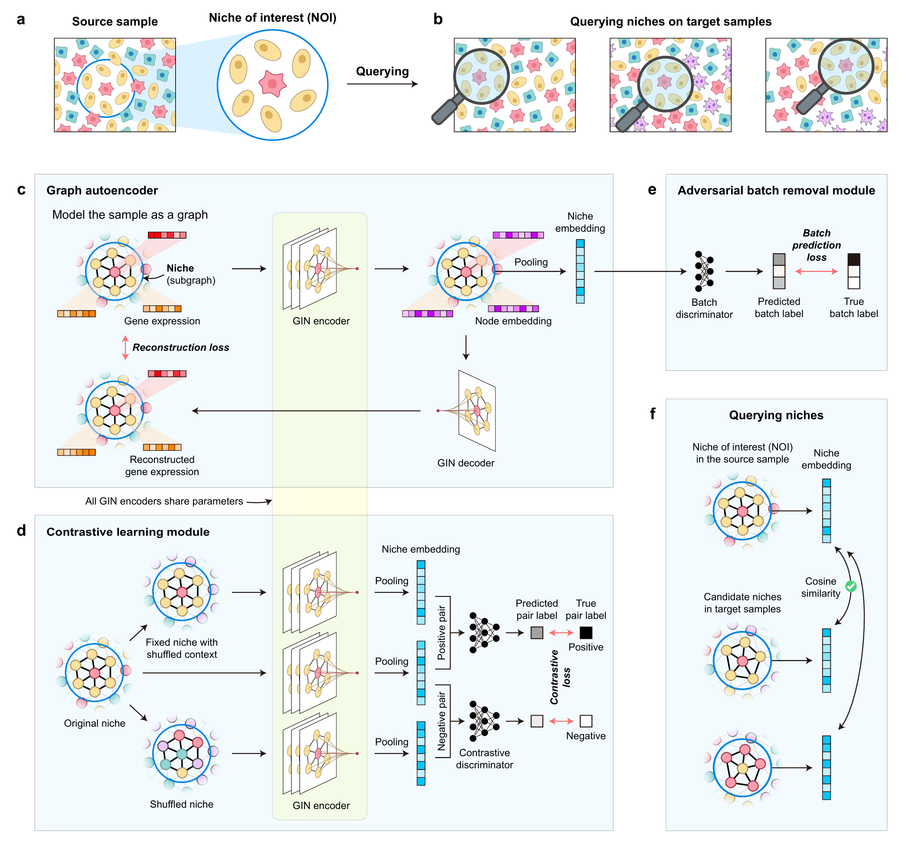

Querying niches on spatial transcriptomics data
===============================================

.. note::

   This project is under active development.

Overview
--------

Cells in multicellular organisms coordinate to form functional niches. With spatial transcriptomics (ST) enabling gene expression profiling in spatial contexts, it has become increasingly evident that spatial niches serve as cohesive and recurrent units in physiological and pathological processes. Such recurrence suggests that tissue organization may be built from conserved multicellular patterns and motivates a query-based paradigm for systematically comparing and searching them across datasets. In this work, we defined the niche-query task as identifying spatial structures similar to a given niche of interest (NOI) across ST samples, and developed QueST, a specialized method for solving this task. QueST represents tissues as collections of local multicellular assemblages and learns assemblage representations through contrastive learning, while incorporating adversarial training to reduce sample-specific variation. In simulations and real benchmark datasets, QueST outperformed existing methods repurposed for niche querying, accurately retrieving corresponding spatial structures across heterogeneous tissue contexts and sequencing platforms. Applied to tertiary lymphoid structures (TLSs) in renal and lung cancers, QueST revealed distinct TLS states associated with patient prognosis and uncovered conserved and divergent spatial architectures across cancer types. These results demonstrate that QueST enables systematic, quantitative profiling of spatial niches across samples, providing a powerful tool to dissect spatial tissue architecture in health and disease.

Contents
--------

.. toctree::

   installation.md
   Tutorial 1 Querying niches on simulation data.ipynb
   Tutorial 2 Niche query benchmark on DLPFC dataset.ipynb
   Tutorial 3 Querying niches across different technologies.ipynb
   Tutorial 4 Analyze Tertiary Lymphoid Structures on ccRCC.ipynb
   Tutorial 5 Querying ccRCC TLS subtypes in NSCLC.ipynb
   API reference.md
